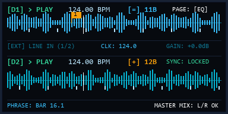
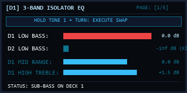
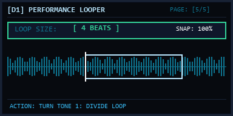
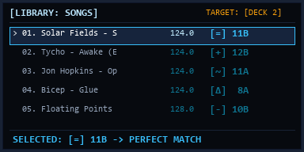
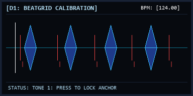

# Drift Zero User Manual
### Official Operational & Technical Reference Manual
**Firmware Version:** `0.6.0` | **Git Commit:** `397d19e` (`main`) | **Revision Date:** `2026-09-25`  
**Hardware Platform:** Drift Zero DJ Console (Model ZDJ-1) | **Target SDK:** [`drift-dj/zero-sdk`](https://github.com/drift-dj/zero-sdk)

## Table of Contents
1. [System Overview & Hardware Architecture](#1-system-overview--hardware-architecture)
2. [DJ Playback Engine & Live Workflow](#2-dj-playback-engine--live-workflow)
3. [Function Knob Pages & Audio Processing](#3-function-knob-pages--audio-processing)
4. [Library Navigation & Harmonic Mixing Engine](#4-library-navigation--harmonic-mixing-engine)
5. [Audio Import Workflows & Rekordbox XML Integration](#5-audio-import-workflows--rekordbox-xml-integration)
6. [Track Metadata, Cuepoints & Beatgrid Calibration](#6-track-metadata-cuepoints--beatgrid-calibration)
7. [Control Panels: Recording, Soundcard Routing & USB Subsystems](#7-control-panels-recording-soundcard-routing--usb-subsystems)
8. [Troubleshooting, Diagnostics & Recovery](#8-troubleshooting-diagnostics--recovery)
9. [Glossary of DJ & Hardware Terms](#9-glossary-of-dj--hardware-terms)


# 1. System Overview & Hardware Architecture

Drift Zero is a standalone dual-deck DJ performance instrument running on an embedded dual-architecture platform. A host Linux system manages user interface rendering, database management, and media decoding, while an integrated ARM Cortex-M7 real-time coprocessor handles low-latency audio input/output (I/O) and hardware digital signal processing (DSP) over shared memory buffers at 44.1 kHz.

Zero operates in three primary UI environments:
1. **DJ Playback:** The live performance screen providing waveform visualizations, beatgrid alignment, looper status, and deck audio manipulation.
2. **Library Menu:** A searchable, key-aware SQLite database browser for tracks, playlists, and file imports.
3. **Control Panels:** Contextual modal overlays for audio routing (Soundcard/Mixer), USB mode configuration, direct recording, and system diagnostics.

## Front Panel Controls & Nomenclature

The physical console provides high-density, multifunction rotary and tactile controls.

```text
+-------------------------------------------------------------+
|  [TONE 1]        [TONE 2]        [TONE 3]     [ 1 EXT . 2 ] |
|  (Encoder+Btn)   (Encoder+Btn)   (Encoder+Btn)     (VOL)    |
|                                                             |
|  +---------------------------------------+   [DECK 1]       |
|  |             OLED DISPLAY              |   [ EXT  ]       |
|  |            (128 x 64 px)              |   [DECK 2]       |
|  +---------------------------------------+                  |
|                                                [NAV/SHIFT]  |
|      ( JOG WHEEL )                [CUE]                     |
|     (Encoder + Push)              [PLAY]                    |
|                                                             |
|  [DECK 1 FADER]      [CROSSFADER]       [DECK 2 FADER]      |
|        |                  |                    |            |
+-------------------------------------------------------------+
```

### 1. Rotary Encoders & Pushbuttons
* **Jog Wheel (`JOG`):** Primary optical encoder with integrated center pushbutton.
  * **Turn:** Nudges playing deck; scrubs stopped deck; scrolls menu lists.
  * **Press:** Selects active menu item; confirms modal dialogs.
  * **Long Press (Hold 0.5s):** Deploys or dismisses the Control Panels overlay (`ZDJ_UI_CONTROL_TOGGLE_PANEL`).
  * **Shift + Turn:** Needledrop fast-scan through loaded track timeline.
  * **Press + Turn:** Adjusts playback tempo in 0.1 BPM increments (adjusts lead tempo when Sync is enabled, or focused deck tempo when independent).
* **Tone Encoders (`TONE 1`, `TONE 2`, `TONE 3`):** Three rotary encoders with integrated push switches (`FN_1`, `FN_2`, `FN_3`). These control the active **Function Knob Page** (EQ, Trim/Cue, Filter, Sync, Looper).
* **Master Volume Rotary (`1 EXT . 2 VOL.` / `OUT`):** Dual-function analog matrix and cue attenuator.
  * **Turn:** Adjusts Main Master L/R Bus Volume.
  * **Press + Turn:** Adjusts Headphone Cue Bus Volume.
  * **Shift + Turn:** Adjusts Recording Bus Gain.

### 2. Transport & Navigation Buttons
* **Play / Pause (`PLAY`):**
  * **Press:** Starts or pauses playback on the focused deck.
  * **Shift + Press:** Toggles background session recording (`Start/Stop Recording`).
* **Cue (`CUE`):**
  * **Press & Hold:** Auditions audio from the active cuepoint.
  * **Release:** Instantly returns playhead to cuepoint and stops audio.
  * **Shift + Press:** Advances to the next stored cuepoint (`1` through `8`).
* **Nav / Shift (`NAV/SHIFT`):**
  * **Press:** Toggles Library Menu overlay.
  * **Hold:** Modifies buttons and encoders to secondary functions.
* **Deck Select Buttons (`DECK 1`, `EXT`, `DECK 2`):**
  * **Press:** Focuses the Playback UI and Function Knob assignments on Deck 1, Ext Deck, or Deck 2.
  * **Press Focused Deck:** Cycles forward through Function Knob Pages.
  * **Shift + Press Focused Deck:** Cycles backward through Function Knob Pages.
  * **Inside Control Panels:** Navigates left/right between panel tabs.

### 3. Faders
* **Deck 1 & Deck 2 Channel Faders:** Smooth linear faders controlling direct deck volume into the mix bus.
* **Crossfader:** Low-friction horizontal fader transitioning audio between Deck 1 and Deck 2 with software-selectable curves (fast cut or linear blend).

## Back Panel Connections & Power Architecture

```text
+-------------------------------------------------------------+
|  [POWER]   (OUT 1)   (OUT 2)   (IN 1)   (IN 2)   [ USB-C ]  |
+-------------------------------------------------------------+
```

* **Power Button (`POWER`):**
  * **Hold 1 Second:** Powers on console.
  * **Hold 6 Seconds:** Executes safe Linux system shutdown and powers off hardware.
* **Analog Audio Outputs (`OUTPUT 1`, `OUTPUT 2`):**
  * Dual 3.5 mm (1/8") Tip-Ring-Sleeve (TRS) stereo analog outputs.
  * Default routing: `OUTPUT 1` = Main Master Mix (L/R); `OUTPUT 2` = Headphone Monitor / Cue Bus.
* **Analog Audio Inputs (`INPUT 1`, `INPUT 2`):**
  * Dual 3.5 mm (1/8") TRS stereo line-level analog inputs routed to the ARM Cortex-M7 analog-to-digital converter (ADC) stage.
  * Signals route to the `EXT` Deck for live EQ/filtering or directly to the session recording bus.
* **USB-C Port:**
  * Dual-role USB 2.0 controller:
    * **USB Host Mode:** Supplies 5V bus power to external USB flash drives, SSDs, or class-compliant USB MIDI controllers.
    * **USB Gadget Mode:** Connects Zero to a host workstation as a USB Mass Storage drive, a 4-in/4-out USB audio interface, or a USB MIDI interface.

> [!IMPORTANT]
> **Interconnect Cables for Professional Audio Equipment**  
> Zero uses standard 3.5 mm (1/8") TRS stereo jacks. To interface with professional DJ mixers, audio interfaces, or active studio monitors, use a **3.5 mm TRS stereo to dual RCA male** or **3.5 mm TRS stereo to dual 1/4" TS male** breakout cable. Connecting a mono TS cable directly into Zero shorts the right audio channel to ground.

Connect power before attaching high-drain USB storage devices.

> [!WARNING]
> **Power Requirements & Brownout Prevention**  
> Drift Zero requires a stable 5V DC power supply capable of delivering at least 2.0A (10W). Powering the unit from unpowered USB hubs or low-current legacy USB-A ports can cause voltage drops during heavy bass transients, resulting in screen flickering or sudden hardware resets.


# 2. DJ Playback Engine & Live Workflow

DJ Playback Mode provides real-time audio telemetry, waveform visualization, playhead positioning, and deck control on the 128x64 OLED display.

## Screen Visualization Layout

The display divides into three horizontal monitoring bands: Deck 1 (top), External Deck / Clock monitor (center), and Deck 2 (bottom).



```text
+=============================================================+
| [D1] > PLAY   124.00 BPM  [=] 11B             PAGE: [EQ]    |
| |WWWWWWWWW|WWWWWWw..w.........|  [1]     L: -2dB M: 0dB H: 0|
| . . . | . . . | . . . | . . . | (SYNC)                      |
+-------------------------------------------------------------+
| [EXT] IN 1/2  LINE LEVEL  [TRIM: +0.0dB]      CLK: 124.0 BPM|
+-------------------------------------------------------------+
| [D2] || PAUSE 124.00 BPM  [+] 12B             PAGE: [TRIM]  |
| |..w...WWWWWWWWWWWWww.........|  [1] [2] PFL: ON  GAIN: 0dB |
| . . . | . . . | . . . | . . . | (FOLLOWER)                  |
+=============================================================+
```

### Visual Telemetry Elements
* **Dynamic Waveform Display:** Renders audio amplitude and transient profiles decoded by FFmpeg in real time.
* **Playhead Marker:** A vertical line (`|`) indicating current playback position relative to total duration.
* **Beatgrid Ticks:** Baseline tick marks (`. . . |`) indicating quarter-note beat intervals generated by library analysis or Rekordbox XML imports.
* **Cuepoint Markers:** Numerical indicators (`[1]`, `[2]`) showing stored hotcue locations along the track timeline.
* **Knob Page Header:** The right column indicates the current DSP assignment for encoders `TONE 1`, `TONE 2`, and `TONE 3`.

## Procedure: Beatmatching & Phase-Aligning Two Tracks

1. Press `DECK 2`. Deck 2 receives UI focus, and its transport parameters highlight on screen.
2. Cycle Deck 2 to the `TRIM/CUE` page and press `TONE 2`. Pre-Fader Listen engages (`PFL: ON`), routing Deck 2 audio to the headphone monitor bus.
3. Hold `NAV/SHIFT` and turn `JOG`. The playhead rapidly jumps across bars through the track intro to the first transient.
4. Release `NAV/SHIFT` and turn `JOG` in scrub mode. The playhead moves in fine sample increments to align directly on the kick drum downbeat.
5. Cycle the knob page to `SYNC` and press `TONE 1`. Deck 2 tempo matches Deck 1 BPM, and the beatgrid locks phase with the session leader.
6. Press `PLAY` on Deck 2 on the downbeat of a phrase. Deck 2 begins playback aligned to the master clock.
7. Turn `JOG` clockwise or counter-clockwise if transient adjustment is required. Playback temporarily accelerates or decelerates to align phase without altering the base tempo setting.
8. Raise `DECK 2 FADER` while turning `TONE 1` on the `EQ` page to execute the low-frequency transition. The incoming track blends into the master mix bus.

## Jog Wheel Operation

The `JOG` encoder adapts function based on transport state and modifier buttons:

| Physical Input | Transport State | System Operation |
|---|---|---|
| **Turn** | Deck Playing | **Nudge (Pitch Bend):** Temporarily accelerates or decelerates playback to adjust phase alignment. Base tempo is unchanged. |
| **Turn** | Deck Stopped | **Scrub:** Moves the playhead forward or backward at fine resolution for cuepoint positioning. |
| **Shift + Turn** | Any State | **Needledrop:** Scans the playhead in multi-bar increments to locate musical sections quickly. |
| **Press + Turn** | Sync Disabled | **Manual Tempo:** Adjusts focused deck playback tempo in 0.1 BPM increments. |
| **Press + Turn** | Sync Enabled | **Master Lead Tempo:** Adjusts session master tempo. All follower decks track the change. |

## Transport & Cuepoint Mechanics

### Play / Pause (`PLAY`)
* **Press:** Toggles audio playback on the focused deck. Audio resumes instantly from the current playhead buffer.
* **Shift + Press:** Toggles background session recording to internal storage. The on-screen `[REC]` badge illuminates when active.

### Cue (`CUE`)
* **Press & Hold:** Auditions playback from the active cuepoint. Audio plays while the button is held. Releasing the button returns the playhead to the cuepoint and halts playback.
* **Cue Latch (`CUE` + `PLAY`):** While holding `CUE`, pressing `PLAY` latches playback into continuous play mode. Releasing `CUE` does not stop playback.
* **Cycle Cuepoints (`SHIFT + CUE`):** Advances the active cue index to the next stored bookmark (`1` through `8`).

## Time-Scale Modification (TSM) Engine

Zero incorporates real-time audio time-stretching and pitch-shifting nodes (`zdj_tsm_tempo_node.c`):
* **Tempo Mode (Key Lock):** When tempo changes via Sync or manual Jog commands, the DSP engine scales playback duration while holding musical pitch constant. Vocal and harmonic frequencies maintain their original pitch across tempo adjustments.
* **Pitch Mode (Variable Speed):** When Key Lock is disabled in Settings, tempo adjustments scale playback sample rate directly. Pitch shifts proportionally with playback speed: increasing BPM raises pitch; decreasing BPM lowers pitch.

## Failure Modes & Troubleshooting

| Condition | Symptom | Root Cause | Corrective Action |
|---|---|---|---|
| Phase drift during playback | Synced deck gradually falls out of alignment | Inaccurate beatgrid analysis on variable-tempo audio | Calibrate beatgrid downbeat and tempo in `Station Edit Mode`, or nudge manually using `JOG`. |
| Audio stutter on transport start | Playback exhibits crackle when pressing `PLAY` | Storage read latency or background file scan overhead | Ensure background analysis is complete before starting live playback (`ZDJ_LIBRARY_ANALYSIS_STATE_IDLE`). |
| Cue fails to return to start | Releasing `CUE` leaves audio playing | Transport latched into continuous playback via `PLAY` | Press `PLAY` to pause the deck, then press `CUE` to reset playhead to the anchor. |


# 3. Function Knob Pages & Audio Processing

The three rotary encoders at the top of the console (`TONE 1`, `TONE 2`, `TONE 3`) dynamically control deck digital signal processing (DSP) functions according to the active **Function Knob Page**.

## Page Navigation & Deck Assignment

* **Deck Selection:** Press `DECK 1`, `EXT`, or `DECK 2` to bind the Function Knobs to that deck.
* **Cycling Pages Forward:** Press the active Deck Select button to advance through that deck's available Function Knob Pages.
* **Cycling Pages Backward:** Hold `NAV/SHIFT` and press the active Deck Select button to reverse the cycle.
* **Reordering Pages:** Go to `Control Panels > Settings > UI Settings > Knob Pages` to show, hide, or reorder available pages.

## Function Knob Page Matrix

### 1. 3-Band Isolator Equalizer (`EQ`)

Provides 3-band isolator equalization with total band kill (-inf) and +6 dB boost.



```text
+=============================================================+
| [D1] EQ ISOLATOR      SWAP: [D1 <-> D2]       PAGE: [1/5]   |
| LOW:  [-12dB]  [||||......] (TONE 1: TURN=ADJ / PRESS+TURN) |
| MID:  [  0dB]  [||||||....] (TONE 2: TURN)                  |
| HIGH: [ +2dB]  [||||||||..] (TONE 3: TURN)                  |
+=============================================================+
```

* **`TONE 1` (Turn):** Adjusts Low EQ (-inf to +6 dB).
* **`TONE 1` (Press + Turn):** **Bass Swap:** Continuously adjusts Deck 1 and Deck 2 Low EQ in inverse directions. Rotating clockwise attenuates Deck 1 low frequencies while proportionally boosting Deck 2 low frequencies (`zdj_soundcard_deck.c`).
* **`TONE 2` (Turn):** Adjusts Mid EQ (-inf to +6 dB).
* **`TONE 3` (Turn):** Adjusts High EQ (-inf to +6 dB).

#### Procedure: Low-Frequency Bass Swap Transition

1. Raise `DECK 2 FADER` to full volume with Deck 2 Low EQ set to minimum (-inf). Deck 2 mids and highs become audible over Deck 1.
2. Press and rotate `TONE 1` clockwise on Beat 1 of a musical phrase. Deck 1 low frequencies attenuate while Deck 2 low frequencies increase in inverse proportion.
3. Lower `DECK 1 FADER` to zero. Deck 2 now carries the full frequency spectrum of the mix.

### 2. Deck Gain & Headphone Monitoring (`TRIM/CUE`)

Manages pre-fader channel amplification and headphone cue bus routing.

* **`TONE 1` (Turn):** Adjusts Deck Pre-Fader Gain (-12 dB to +12 dB).
* **`TONE 2` (Press):** Toggles Pre-Fader Listen (PFL / Cue Mute) for this deck on the headphone monitor bus.
* **`TONE 2` (Turn):** Adjusts headphone cue balance for this deck.

### 3. Bipolar Resonant Filter (`FILTER`)

```text
+=============================================================+
| [D1] BIPOLAR FILTER   STATE: [HPF ACTIVE]     PAGE: [3/5]   |
| CUTOFF: [4.2 kHz]     [.........||||] (TONE 1: TURN/PRESS=R)|
| RESONANCE: [ 45%]     [|||||........] (TONE 2: TURN)        |
| MODE: 24dB/OCT        SWEEP: HIGH-PASS                      |
+=============================================================+
```

A dual-topology 24 dB/octave sweep filter combining Low-Pass and High-Pass operation on a single control:
* **`TONE 1` (Turn):** Sweeps cutoff frequency:
  * **Counter-Clockwise:** Low-Pass Filter (LPF). Attenuates high frequencies progressively.
  * **Center (12 O'Clock):** Filter bypassed.
  * **Clockwise:** High-Pass Filter (HPF). Attenuates low and mid frequencies progressively.
* **`TONE 1` (Press):** Resets filter cutoff immediately to center bypass.
* **`TONE 2` (Turn):** Adjusts filter resonance (Q factor).

### 4. Beat Sync Engine (`SYNC`)

Aligns tempo and phase to the session master clock using beatgrid reference anchors:
* **`TONE 1` (Press):** Toggles Sync active. The follower deck's tempo and transient phase lock to the master lead deck.
* **`TONE 1` (Turn):** Adjusts phase offset against the master clock.

### 5. Quantized Looper & Beat Skip (`LOOP/SKIP`)



```text
+=============================================================+
| [D1] LOOPER ACTIVE    [ 4 BEATS ]             PAGE: [5/5]   |
| LOOP RANGE: BAR 16.1 -> 17.1 (SNAP: ON) (TONE 1: PRESS=EXIT)|
| QUANTIZE: [ 1 BEAT ]  MOVE: [+- 1 BAR]  (TONE 2: MOVE/QUANT)|
| BEAT SKIP: [+- 1 BEAT]                  (TONE 3: SKIP)      |
+=============================================================+
```

Controls loop capture, boundary modulation, and position jumping:

| Control | State: Loop Inactive (`LOOP OFF`) | State: Loop Active (`LOOP ON`) |
|---|---|---|
| **`TONE 1` (Press)** | **Engage Loop:** Captures loop of selected length at playhead. | **Exit Loop:** Releases loop boundary and resumes linear playback. |
| **`TONE 1` (Turn)** | **Set Default Length:** Selects length (1/16, 1/8, 1/4, 1/2, 1, 2, 4, 8, 16, 32 beats). | **Resize Active Loop:** Dynamically doubles or halves the active loop length. |
| **`TONE 2` (Turn)** | No action | **Move Loop:** Shifts active loop boundaries forward or backward by 1 bar. |
| **`TONE 2` (Press)** | **Toggle Quantize:** Enforces beatgrid snap. | **Toggle Quantize:** Enforces beatgrid snap. |
| **`TONE 2` (Press + Turn)** | Adjusts Quantize grid resolution (1/4, 1/2, 1 beat). | Adjusts Quantize grid resolution (1/4, 1/2, 1 beat). |
| **`TONE 3` (Turn)** | **Beat Skip:** Jumps playhead forward or backward by the quantize interval. | **Beat Skip:** Shifts loop frame by the quantize interval. |

#### Procedure: Capturing, Halving, and Exiting a Quantized Loop

1. Go to the `LOOP/SKIP` page on Deck 1. The loop control parameters display.
2. Turn `TONE 1` to select `4 Beats`. The display confirms `[ 4 BEATS ]`.
3. Press `TONE 1` on the downbeat of a musical section. Playhead loops continuously across the 4-beat boundary.
4. Turn `TONE 1` counter-clockwise during playback. The loop duration halves sequentially to `2 Beats`, `1 Beat`, and `1/2 Beat`.
5. Press `TONE 1`. The loop releases, and continuous audio playback resumes in sync with the track timeline.

## External (`EXT`) Deck Specifications & Architecture

When the `EXT` Deck receives focus, audio originates from the analog rear-panel line jacks (`INPUT 1` or `INPUT 2`). Because incoming line audio is processed directly by the ARM Cortex-M7 ADC without non-volatile storage or pre-calculated beatgrid metadata:
* The `EXT` Deck supports **`EQ`**, **`TRIM/CUE`**, **`FILTER`**, and **`SYNC`** (tracking external analog clock pulses).
* The **`LOOP/SKIP`** page is omitted from the Ext Deck cycle. Real-time looping requires RAM-buffered PCM audio tables available only on digital file playback decks.

## Failure Modes & Troubleshooting

| Condition | Symptom | Root Cause | Corrective Action |
|---|---|---|---|
| Bass Swap operates on wrong decks | Turning Tone 1 affects Deck 1 and Ext Deck instead of Deck 2 | Control map bindings set to external input | Ensure Deck 1 and Deck 2 are both active and Ext Deck is bypassed in the soundcard routing matrix. |
| Loop triggers off-beat | Captured loop boundary does not align with transients | Quantize is disabled (`SNAP: OFF`) | Press `TONE 2` on the `LOOP/SKIP` page to enable Quantize (`SNAP: ON`). |
| High-resonance filter screech | High audio peaks or distortion during filter sweep | Filter resonance (`TONE 2`) set above 80% | Turn `TONE 2` counter-clockwise to reduce Q factor before sweeping cutoff frequency. |


# 4. Library Navigation & Harmonic Mixing Engine

The Library Menu provides hierarchical browsing across internal solid-state storage and mounted external USB drives. It incorporates real-time harmonic compatibility evaluation based on the Camelot wheel.

## Library Navigation Architecture

* **Open / Close Library:** Press `NAV/SHIFT` to toggle the Library Menu overlay.
* **Scroll & Browse:** Turn `JOG` to navigate lists vertically.
* **Load Track:** Press `JOG` on any track to load audio, waveform, beatgrid, and cuepoint data into the focused deck.
* **Back Navigation:** Scroll to the list top and press `JOG` on `[ BACK ]`, or press `NAV/SHIFT` to return directly to the performance screen.



```text
+=============================================================+
| [LIBRARY: ALL SONGS]   (SORT: KEY)            TARGET: [D2]  |
| [ < BACK TO ROOT ]                                          |
| 01. Solar Fields - Sol          124.0 BPM  [=] 11B (PERFECT)|
|>02. Tycho - Awake (Edit)        124.0 BPM  [+] 12B (LIFT)   |
| 03. Jon Hopkins - Open Eye      124.0 BPM  [~] 11A (MODE)   |
| 04. Bicep - Glue                124.0 BPM  [Δ]  8A (MOOD)   |
| 05. Floating Points - LesAlp    128.0 BPM  [-] 10B (DROP)   |
+=============================================================+
```

### Row Annotations & Metadata Flags
Row indicators can be enabled or disabled under `Control Panels > Settings > UI Settings > Library Menu`:
* **BPM Tag:** Analyzed tempo (e.g. `124.0`).
* **Key Tag:** Musical key notation (e.g. `11B` or `A maj`).
* **Harmonic Match Indicator:** Real-time compatibility glyph evaluated against the currently playing audio deck.
* **Error Tag (`[!Err]`):** Flags corrupt headers or unsupported audio encodings.

## Procedure: Loading Tracks by Harmonic Compatibility

1. Press `DECK 2`. The header displays `TARGET: [D2]`.
2. Press `NAV/SHIFT`. The Library Menu displays.
3. Turn `JOG` to highlight `Songs`. The root song catalog displays.
4. Turn `JOG` to inspect candidate tracks. Compare the bracketed compatibility glyphs against the lead track:
   * Select `[=]` for identical key signature and zero harmonic dissonance.
   * Select `[+]` or `[++]` for upward energy transitions.
   * Select `[-]` or `[--]` for downward energy transitions.
   * Select `[~]` for relative Major/Minor mode transitions.
   * Select `[Δ]` for parallel key transitions.
5. Press `JOG` on the selected track. The track loads into Deck 2, and the display returns to DJ Playback.

## Harmonic Mixing Engine & Camelot Lookup Table

Zero evaluates musical harmony using an embedded 26x26 key lookup table (`_zdj_library_camelot_lut` in `zdj_library_api_key.c`). The engine compares the candidate song's key against the deck currently active on the master mix bus.

The Camelot system numbers the Circle of Fifths from `1` to `12`:
* **`B`** denotes Major scales (e.g. `8B` = C Major, `11B` = A Major).
* **`A`** denotes Minor scales (e.g. `5A` = C Minor, `8A` = A Minor).

```text
                     12B (E) / 12A (Dbm)
               11B (A)                 1B (B)
             11A (F#m)                 1A (Abm)
         10B (D)                             2B (F#)
         10A (Bm)                            2A (Ebm)
        9B (G)                                  3B (Db)
        9A (Em)                                 3A (Bbm)
         8B (C)                              4B (Ab)
         8A (Am)                             4A (Fm)
               7B (F)                  5B (Eb)
               7A (Dm)                 5A (Cm)
                      6B (Bb) / 6A (Gm)
```

## Real-Time Compatibility Glyphs

The song list renders distinct glyphs (`zdj_menu_item_view_song.c`) reflecting harmonic intervals:

| Glyph | Internal Enum | Musical Relationship | Harmonic Function |
|:---:|---|---|---|
| **`=`** | `ZDJ_LIBRARY_CAMELOT_EQUAL` | **Exact Key Match** (e.g. `11B` to `11B`) | Zero harmonic tension. Melodic and bass elements mix without dissonance. |
| **`+`** | `ZDJ_LIBRARY_CAMELOT_PLUS` | **Step Boost (+1)** (e.g. `11B` to `12B`) | One step clockwise on Circle of Fifths. Perceived energy elevation. |
| **`++`** | `ZDJ_LIBRARY_CAMELOT_PLUS_PLUS` | **Energy Surge (+2)** (e.g. `11B` to `1B`) | Two steps clockwise. Sharp key modulation for peak transitions. |
| **`-`** | `ZDJ_LIBRARY_CAMELOT_MINUS` | **Step Drop (-1)** (e.g. `11B` to `10B`) | One step counter-clockwise. Harmonically releases tension. |
| **`--`** | `ZDJ_LIBRARY_CAMELOT_MINUS_MINUS` | **Deep Drop (-2)** (e.g. `11B` to `9B`) | Two steps counter-clockwise. Melodic downshift. |
| **`~`** | `ZDJ_LIBRARY_CAMELOT_TILDA` | **Relative Mode Swap** (e.g. `11B` to `11A`) | Uses identical scale pitches with a shifted tonal center (Major to Minor). |
| **`Δ`** | `ZDJ_LIBRARY_CAMELOT_DELTA` | **Parallel Root Modulation** (e.g. `11B` [A Maj] to `8A` [A Min]) | Root pitch remains unchanged while scale tonality shifts between Major and Minor. |
| *(None)* | `ZDJ_LIBRARY_CAMELOT_NONE` | **Incompatible / Unmatched** | Dissonant scale intervals. No badge is rendered. |

> [!NOTE]
> Early documentation drafts erroneously cited a `"???"` wildcard indicator. In production firmware, non-matching musical keys leave the compatibility badge area blank.

## Failure Modes & Troubleshooting

| Condition | Symptom | Root Cause | Corrective Action |
|---|---|---|---|
| Track loads into wrong deck | Audio plays on active deck instead of cue deck | Target focus was set to playing deck before load | Check `TARGET: [D1/D2]` in the top-right corner of the library before pressing `JOG`. Press `DECK 1` or `DECK 2` to change destination. |
| Key tag displays `---` | No key or compatibility glyph is shown | Track analysis incomplete or audio file has insufficient harmonic content | Let background analysis complete, or enter `Station Edit Mode` to manually assign key metadata. |
| Red `[!Err]` tag on song row | Track refuses to load when selected | File missing from disk, corrupted audio header, or unreadable storage sector | Run `File System Check` in Settings, or re-import the file over USB. |


# 5. Audio Import Workflows & Rekordbox XML Integration

Drift Zero supports three methods for populating its internal SQLite audio database: direct USB-C drive imports, workstation Mass Storage file transfers (Drive Mode), and Pioneer Rekordbox XML collection imports with cuepoint and beatgrid preservation.

## Workflow 1: Direct USB-C Flash Drive Import

1. Go to `Control Panels > USB Setup` and verify the controller role is set to `USB Host`.
2. Connect a USB-C flash drive or portable SSD to the rear USB-C port. The drive mounts to `/media/usb/`.
3. Press `NAV/SHIFT` to open the Library Menu, scroll to `+ Add Music`, and select `Browse Files`. The file system browser displays.
4. Turn `JOG` to highlight an audio file (`.wav`, `.aif`, `.mp3`, `.flac`) or directory, and press `JOG`. The selected files copy to internal storage.
5. Background analysis commences automatically (`ZDJ_LIBRARY_ANALYSIS_STATE_SCAN`). The background thread decodes audio transients via FFmpeg, calculates BPM, constructs beatgrid anchors, and logs Camelot musical keys to the SQLite database.

## Workflow 2: Workstation File Transfer (Drive Mode)

1. Connect Zero to a host computer using a high-speed USB-C data cable.
2. Go to `Library Menu > + Add Music > Drive Mode` (or `Control Panels > USB Setup > Drive Mode`). Zero enables its USB Mass Storage gadget driver (`zdj_usb_driver.c`).
3. Observe the host computer desktop. The internal storage partition mounts as an external mass storage drive.
4. Drag audio files and directories into the music partition.
5. Eject the volume from the host operating system to flush disk write caches.
6. Press `JOG` on Zero. Drive Mode exits, and the primary performance interface returns.
7. Go to `Library Menu > + Add Music > Scan for New Files`. Zero scans local storage for newly copied files and enqueues them for background audio analysis.

## Workflow 3: Rekordbox XML Collection Import

Rekordbox XML files contain metadata, cuepoint markers, and playlist hierarchies; they do not contain audio data. Both the XML file and the corresponding audio folder must reside on Zero's storage for successful ingestion.

```text
+-------------------------------------------------------------+
| REKORDBOX WORKSTATION                                       |
| 1. Export collection as XML (rekordbox.xml)                 |
| 2. Connect Zero in Drive Mode and copy XML + Audio root     |
+-------------------------------------------------------------+
                             |
                             v
+-------------------------------------------------------------+
| DRIFT ZERO HARDWARE CONSOLE                                 |
| 3. Eject drive on computer and exit Drive Mode on Zero      |
| 4. Go to Library Menu > + Add Music > Rekordbox XML         |
| 5. Dialog 1/3: Select rekordbox.xml file                    |
| 6. Dialog 2/3: Select audio root directory (/Contents)      |
| 7. Dialog 3/3: Set Error Policy (Skip Errors / Abort)       |
| 8. Execute database ingestion and playlist generation       |
+-------------------------------------------------------------+
```

### Verified Import Procedure

1. In Rekordbox on your workstation, go to `File > Export Collection in XML format` and save `rekordbox.xml`.
2. Connect Zero to your computer, select `Drive Mode`, and wait for the volume to mount.
3. Copy `rekordbox.xml` to the root of the Zero drive volume, and copy your Rekordbox audio directory (typically `/Contents`) onto the drive.
4. Eject the drive volume on your computer operating system.
5. Press `JOG` on Zero to terminate Drive Mode. The normal UI displays.
6. Go to `Library Menu > + Add Music > Rekordbox XML`. The XML selection dialog displays.

```text
+=============================================================+
| [IMPORT: REKORDBOX XML]               DIALOG 1/3: LOCATE XML|
| SELECT XML FILE:                                            |
|   ../                                                       |
| > rekordbox.xml                       (14.2 MB) [2,420 TRKS]|
|   backup_collection.xml                (9.8 MB)             |
+=============================================================+
```

7. Turn `JOG` to highlight `rekordbox.xml` and press `JOG`. The audio root selection dialog displays.

```text
+=============================================================+
| [IMPORT: REKORDBOX XML]               DIALOG 2/3: AUDIO ROOT|
|>[ SELECT THIS DIR: /media/internal/Contents ]               |
|   ../                                                       |
|   Artist_A/                                                 |
|   Artist_B/                                                 |
+=============================================================+
```

8. Turn `JOG` to highlight the folder where audio files were placed (e.g. `/media/internal/Contents`) and press `JOG` on `[ Select this dir ]`. The policy configuration dialog displays.

```text
+=============================================================+
| [IMPORT: REKORDBOX XML]               DIALOG 3/3: POLICIES  |
| ERROR POLICY:      >[ SKIP ERRORS ]     [ ABORT ON ERROR ]  |
| CUEPOINTS:          [ IMPORT ALL (8) ]                      |
| BEATGRIDS:          [ OVERWRITE EXISTING ]                  |
| > [ BEGIN INGESTION: 2,420 TRACKS ]                         |
+=============================================================+
```

9. Select the desired error policy:
   * **Skip Errors:** Continues importing remaining tracks if an unreadable audio file or missing path is encountered.
   * **Abort on Error:** Halts execution immediately upon encountering an unresolvable reference.
10. Press `JOG` on `[ BEGIN INGESTION ]`. Zero parses the XML tree using `libxml2`, constructs database entities (`zdj_library_create_rb_xml_import_song_graph`), registers TrackIDs, imports stored `<POSITIONMARK>` hotcues, and generates playlist trees.

## Failure Modes & Troubleshooting

| Condition | Symptom | Root Cause | Corrective Action |
|---|---|---|---|
| Tracks listed but will not play | Error displayed upon loading imported Rekordbox track | XML file was copied without copying the underlying audio files | Copy the audio directory to Zero's storage and repeat the XML import, selecting the audio folder in Dialog 2/3. |
| Zero not recognized over USB | Computer does not detect external drive volume | Zero is set to Host Mode instead of Gadget Mode, or cable is power-only | Go to `Control Panels > USB Setup` and switch to `Gadget Mode`. Use a verified USB-C high-speed data cable. |
| Filesystem mounts read-only | Workstation rejects file write operations | Volume was unplugged without unmounting, setting dirty flag | Run `Control Panels > Settings > System > File System Check` to clear the journal lock. |


# 6. Track Metadata, Cuepoints & Beatgrid Calibration

While Zero automatically analyzes imported audio, parameters can be inspected and manually calibrated using Station Edit Modes (`zdj_control_map.c`):
* `STATION_1_EDIT_SONG` / `STATION_2_EDIT_SONG`: Metadata inspection and manual overrides.
* `STATION_1_EDIT_CUEPOINT` / `STATION_2_EDIT_CUEPOINT`: Real-time hotcue programming and deletion.
* `STATION_1_EDIT_BEATGRID` / `STATION_2_EDIT_BEATGRID`: Transient grid anchor and interval alignment.

## 1. Cuepoint Management (`EDIT_CUEPOINT`)

```text
+=============================================================+
| [D1: CUEPOINT EDIT]   SLOT: [2/8]             TIME: 01:24.32|
| |...WWWWWW|WWWWWWw.....|  [1]>[2]             TONE 1: COMMIT|
| (JOG: SCRUB POSITION) (NAV+TONE 1: MOVE)      TONE 3: DELETE|
+=============================================================+
```

Zero supports up to 8 stored hotcue points per track. Cuepoints are stored non-volatilely in the internal SQLite database and persist across reboots.

### Procedure: Programming and Auditioning Hotcues

1. Press `PLAY` to stop playback on the deck to edit. Playback halts.
2. Long-press `JOG` on the loaded track and select `Edit Cuepoints` (or hold `NAV/SHIFT` and press `CUE`). The cuepoint editor displays.
3. Turn `JOG` in scrub mode. The playhead moves along the waveform to align with the desired transient.
4. Press `TONE 1`. The active cue slot (e.g. `[2]`) assigns to the current playhead timestamp.
5. Press and hold `CUE`. Audio plays back from the cuepoint while held, and returns to the cuepoint upon release.
6. Hold `NAV/SHIFT` and press `TONE 3` if a cuepoint requires removal. The selected cue slot clears.

## 2. Beatgrid Calibration (`EDIT_BEATGRID`)



```text
+=============================================================+
| [D1: BEATGRID CALIBRATION]                    BPM: [124.00] |
| |===||====|====|====| (ANCHOR: BAR 1.1)       TONE 1: ANCHOR|
| GRID PHASE: [+0.0 ms]  SPAN: [NORMAL]         TONE 2: STRETCH|
| (JOG: FINE NUDGE)     (TONE 2 P+T: 2X//2)     TONE 3: PHASE |
+=============================================================+
```

Precise beatgrids are required for automated Sync, quantized looping, and beat skipping.

### Procedure: Calibrating a Drifting Beatgrid

1. Select `Edit Beatgrid` from the track options menu. The display zooms 400% on the waveform transients.
2. Turn `JOG` in scrub mode to locate the primary kick drum marking Bar 1, Beat 1. The playhead rests on the initial transient.
3. Press `TONE 1`. A solid vertical anchor locks to this transient, establishing the reference origin for all subsequent quarter-note ticks.
4. Turn `JOG` forward 32 bars to verify downstream alignment against later kick transients:
   * **Ticks behind transients (Grid interval too long):** Turn `TONE 2` clockwise to contract the beat interval (increasing calculated BPM).
   * **Ticks ahead of transients (Grid interval too short):** Turn `TONE 2` counter-clockwise to expand the beat interval (decreasing calculated BPM).
5. Press and turn `TONE 2` if the track was analyzed at half or double tempo (e.g. 70 BPM instead of 140 BPM). The tempo multiplier toggles between `1x`, `2x`, and `/2`.
6. Press `TONE 1`. The calibrated grid anchors and tempo write to the SQLite database.

## 3. Metadata Overrides (`EDIT_SONG`)

Within the song editor modal:
* **Key Override:** If harmonic analysis detected an ambiguous modal scale, turn `TONE 1` to override the Camelot key tag (e.g. `8A` to `8B`).
* **Gain Calibration:** Turn `TONE 2` to configure a persistent track-level gain offset. Tracks mastered at low volumes can be boosted to match modern standards upon loading.

## Failure Modes & Troubleshooting

| Condition | Symptom | Root Cause | Corrective Action |
|---|---|---|---|
| Cuepoint does not save | Configured cuepoint vanishes after restarting console | Database write transaction was interrupted | Ensure `TONE 1 (Commit)` is pressed before exiting the cuepoint editing modal. |
| Beatgrid drifts progressively | Grid aligns at start but desynchronizes toward track end | Audio file was recorded from vinyl with tempo flutter | Lock a secondary anchor later in the track, or disable automated Sync and nudge manually using `JOG`. |
| Tempo halved on drum-and-bass | Display reads 87 BPM instead of 174 BPM | Transient detector detected half-time kick intervals | Press and turn `TONE 2` in the beatgrid editor to apply the `2x` multiplier. |


# 7. Control Panels: Recording, Soundcard Routing & USB Subsystems

The Control Panels provide system configuration, input/output (I/O) signal routing, session recording, and diagnostic utilities.

## Deploying & Navigating Control Panels

* **Deploy / Dismiss Panels:** Long-press `JOG` (hold for 0.5s) from any screen to toggle the Control Panel overlay (`ZDJ_UI_CONTROL_TOGGLE_PANEL`).
* **Switch Panels:** Press `DECK 1` (Previous Panel) or `DECK 2` (Next Panel) to navigate horizontally between panel tabs.
* **Select & Adjust:** Turn `JOG` to highlight parameters, and press `JOG` to modify values or deploy submenus.

```text
[ RECORDING ] <-> [ SOUNDCARD / MIXER ] <-> [ FILE BROWSER ] <-> [ USB SETUP ] <-> [ SETTINGS ]
```

## 1. Recording Control Panel (`ZDJ_UI_PANEL_RECORDING`)

The recording engine captures uncompressed 32-bit floating-point, 44.1 kHz stereo WAV audio directly to internal flash storage (`zdj_audio_record_node.c`).

```text
+=============================================================+
| [PANEL: RECORDING]    STATUS: [RECORDING]     TIME: 00:42:15|
| L: [||||||||||||||||||....] -3.2 dB (PEAK)    REC GAIN: -2dB|
| R: [||||||||||||||||||....] -3.2 dB (PEAK)   (SHIFT+VOL=ADJ)|
| FILE: /media/internal/recordings/recording_001.wav          |
| INPUT: >[ MAIN BUS LR ]                                     |
+=============================================================+
```

### Telemetry & Metadata Specifications
* **Active Status:** Displays elapsed session time, real-time peak VU level meters, and the destination filename (`recording_XXX.wav`).
* **Storage Location:** Written to `/media/internal/recordings/`.
* **Database Cataloging:** When recording finalizes, the file is automatically registered in the SQLite library with artist `"Zero Recording"` and title `"recording_XXX"`.
* **Sync Grid Inheritance:** If Sync is engaged during recording, the WAV file automatically inherits the master deck's BPM and beatgrid metadata (`zdj_audio_record_node.c:345`).
* **Record Headroom Gain:** Hold `NAV/SHIFT` and turn `VOL` to adjust digital recording gain (-12 dB to +12 dB). Because audio is stored in 32-bit float, internal mixing cannot clip digitally before writing to disk.

### Procedure: Recording a Live DJ Set

1. Long-press `JOG` for 0.5s. The Control Panels overlay displays.
2. Press `DECK 1` or `DECK 2` until the `RECORDING` tab displays.
3. Turn `VOL` while holding `NAV/SHIFT` to calibrate record bus gain. The peak VU meters reflect input amplitude.
4. Press `TONE 1` (or press `SHIFT + PLAY` from the live performance view). Recording commences, the `[REC]` badge illuminates, and the session timer starts.
5. Press `SHIFT + PLAY` when the set concludes. The audio engine cleanly flushes memory buffers, closes the WAV header, and logs the file to the library.

## 2. Soundcard / Mixer Panel (`ZDJ_UI_PANEL_SOUNDCARD`)

Governs the low-level ALSA audio crossbar and DSP routing matrix (`zdj_soundcard_panel.c`). The panel renders as a horizontally scrolling channel-strip interface.

```text
+=============================================================+
| [PANEL: SOUNDCARD]    ROUTING MATRIX          PRESET: [CLUB]|
| [D1]  [EXT]  [D2]  |  [AUX0]  [CV0]  [MAIN]  [CUE]  [OUT 1] |
| -2dB   0dB   -6dB  |   0dB     PPQN   -1dB   -3dB   STEREO  |
| (JOG: SCROLL CHANNELS) (TONE 1: GAIN) (TONE 2: PAN/ROUTING) |
+=============================================================+
```

### Channel Strips
* **Decks:** Deck 1 (`DECK_1_PREFADE`), Ext Deck (`DECK_EXT_PREFADE`), Deck 2 (`DECK_2_PREFADE`).
* **Auxiliary Busses:** Aux 0 through Aux 3 for sub-mixing and external effects routing.
* **Control Voltage (CV) Busses:** CV 0 through CV 3 for analog clock synchronization (1, 2, or 4 Pulses Per Quarter Note / PPQN).
* **Busses:** Main Bus (`MAIN_BUS`), Headphone Cue Bus (`CUE_BUS`), Record Bus (`RECORD_BUS`).
* **Hardware Ports:** Output 1, Output 2, Input 1, Input 2, and USB I/O.

### Output Port Modes
* **`OUTPUT 1` Assignment:**
  * **Master Stereo (Default):** Primary front-of-house sound system feed (L/R).
  * **Booth Stereo:** Independent secondary monitor feed with dedicated gain trim.
* **`OUTPUT 2` Assignment:**
  * **Headphone Cue (Stereo Default):** Dedicated stereo cue bus with pre-fader listen (PFL) mixing.
  * **Split-Cue Mode (Mono L/R):** Left headphone ear receives the cue bus (PFL); right headphone ear receives the master house mix.

### Procedure: Enabling Split-Cue Monitoring

1. Long-press `JOG` to deploy the Control Panels.
2. Press `DECK 2` until the `SOUNDCARD` panel displays.
3. Turn `JOG` horizontally to highlight the `OUTPUT 2` strip and press `JOG`. The output options menu displays.
4. Turn `JOG` to `Routing Mode` and press `JOG` to select `Split-Cue (Mono L/R)`.
5. Put on headphones. Left ear monitors active PFL channels; right ear monitors the live master bus.
6. Long-press `JOG` to return to DJ Playback.

## 3. File Browser Panel (`ZDJ_UI_PANEL_BROWSER`)

Provides direct navigation of local Linux file partitions, internal storage `/media/internal/`, and external USB devices `/media/usb/`.

* **Audio Auditioning:** Highlight an audio file (`.wav`, `.mp3`) and press `TONE 2`. Audio plays in headphones via the cue bus without interrupting playing decks.
* **File Operations:** Copy, move, or delete files, and stage system `.pkg` update packages.

## 4. USB Setup Panel (`ZDJ_UI_PANEL_USB`)

Configures USB controller operation:

* **USB Host Mode:** Zero acts as the host controller, supplying 5V bus power to attached flash drives, SSDs, and USB MIDI keyboards.
* **USB Gadget Mode:** Zero acts as a peripheral connected to a workstation computer:
  * **Drive Mode (Mass Storage):** Mounts internal storage as an external drive volume.
  * **USB Audio Mode:** Operates as a class-compliant 4-in / 4-out USB audio interface (44.1 kHz, 24-bit PCM) for recording into DAWs.
  * **USB MIDI Mode:** Sends and receives MIDI clock pulses for external hardware sequencer synchronization.

## 5. Settings & Developer Panel (`ZDJ_UI_PANEL_SETTINGS`)

### UI Settings
* **Function Knob Pages:** Toggle visibility or customize order for knob pages (`EQ`, `TRIM`, `FILTER`, `SYNC`, `LOOP`).
* **Library Annotations:** Toggle BPM, Key, and Camelot compatibility badges.
* **Display Contrast:** Calibrate OLED brightness.

### System Settings
* **OS Updates:** Installs signed firmware update archives (`.pkg`).
* **Granular Reset Dialogs:**
  * **Reset Library Database:** Clears SQLite track tables and resets library indices without deleting audio files on disk.
  * **Reset Soundcard DB:** Restores factory audio routing matrices and presets.
  * **Full System Reset:** Returns all settings, soundcard profiles, and UI configurations to factory state.

### Developer & Diagnostics Submenu (`zdj_settings_developer_panel.c`)
*Added in System Version 0.6.0 (PR #33):*
* **Configurable Crash Dialog:** Toggles an on-screen crash notification widget upon unexpected process restart, preventing silent reboots.
* **Crash Log Viewer:** Displays backtraces and core dump information from `/var/log/zdj_crash.log`.
* **DSP Performance Telemetry:** Displays real-time CPU load, audio ring buffer margin, and memory utilization.

## Failure Modes & Troubleshooting

| Condition | Symptom | Root Cause | Corrective Action |
|---|---|---|---|
| Recording stops unexpectedly | Session terminates mid-set | Internal storage partition reached capacity | Verify available disk space in `Settings > System Info` before long recording sessions. |
| Split-Cue delivers identical audio to both ears | Both headphone sides play master mix | PFL not engaged on incoming deck, or Output 2 set to Stereo | Go to `TRIM/CUE` knob page and press `TONE 2` to engage PFL on the auditioning deck. |
| USB Audio not visible in DAW | Workstation audio settings do not list Zero | USB controller is in Host Mode instead of Gadget Audio Mode | Go to `Control Panels > USB Setup`, select `Gadget Mode`, and set profile to `USB Audio`. |


# 8. Troubleshooting, Diagnostics & Recovery

This reference provides failure mode diagnostics, recovery procedures, and developer diagnostic tools for Drift Zero hardware and firmware.

## Hardware Diagnostic & Failure Matrix

| Subsystem | Failure Symptom | Underlying Cause | Corrective Action |
|---|---|---|---|
| **Power & Stability** | OLED display flickers, unit suddenly reboots during bass transients | Input voltage brownout below 4.75V due to insufficient USB power supply | Connect to a dedicated 5V / 2.0A (10W minimum) USB-C power source. Avoid unpowered USB hubs. |
| **USB Connectivity** | Zero is unrecognized by host computer | Zero set to Host Mode, or connected via charge-only cable | Go to `Control Panels > USB Setup`, switch role to `USB Gadget (Drive Mode)`, and verify cable supports USB 2.0 High-Speed data. |
| **Mass Storage** | Host OS mounts drive as read-only; cannot copy tracks | Storage unmounted improperly, setting filesystem dirty flag | Go to `Control Panels > Settings > System > File System Check` to repair journal locks. |
| **Audio Engine** | Audio clicks or dropouts during dense looping | DSP CPU load exceeded 85% headroom limit | Open `Settings > Developer > DSP Telemetry`. Reduce simultaneous 1/16-beat loopers during active background track analysis. |
| **Fader Response** | Zipper noise or stepping artifacts when moving faders | Outdated firmware version without slew smoothing | Verify firmware is updated to version 0.6.0+, which incorporates micro-frame slew interpolation on all faders (PR #31). |
| **Database** | Songs missing from playlists or search crashes | SQLite index corruption following sudden power loss | Go to `Control Panels > Settings > System > Reset Library Database`. Existing audio files on disk remain untouched. |

## Audio Pipeline Slew Smoothing (Firmware 0.6.0+)

System Version 0.6.0 incorporates control smoothing across linear faders, crossfaders, and rotary gain stages (`zdj_soundcard_dsp_gain_pan.c`). Control updates are interpolated over micro-frame sample buffers, eliminating zipper artifacts during rapid fader cuts.

If clicking persists:
1. Verify system firmware version under `Control Panels > Settings > System Info`.
2. Inspect the **DSP Performance Telemetry** view. If audio buffer margin drops below 15%, check background process activity.

## Developer Diagnostics Submenu (PR #33)

Accessed via `Control Panels > Settings > Developer`:
* **Crash Notification Dialog:** When enabled, an unexpected software restart halts execution at a diagnostic screen rather than performing a silent restart.
* **Crash Log Inspection:** Reads backtrace dumps from `/var/log/zdj_crash.log`. Displays register states, faulting memory addresses, and function call stacks.
* **DSP Telemetry:** Displays real-time metrics for:
  * Audio thread execution time (target: < 2.5 ms per 512-sample frame).
  * Cortex-M7 shared memory ring buffer margin.
  * System memory usage and CPU core thermals.

## Hardware Recovery & Config-Mode Boot

If firmware corruption or an interrupted system update prevents normal boot:

### Procedure: Entering Emergency Recovery Mode

1. Hold `POWER` for 6 seconds until all LEDs extinguish. Power turns off completely.
2. Press and hold both `DECK 1` and `DECK 2` Select buttons simultaneously.
3. Press and hold `POWER` for 2 seconds while maintaining pressure on `DECK 1` and `DECK 2`.
4. Release `POWER`. Continue holding `DECK 1` and `DECK 2` until the OLED display illuminates:  
   `=== DRIFT ZERO RECOVERY / CONFIG MODE ===`
5. Connect Zero to a host workstation via USB-C. Zero mounts an emergency read-only recovery partition containing `factory_image.pkg` and `recovery.log`.
6. Copy an official release firmware package into the `update/` directory.
7. Reboot the console. The bootloader verifies package cryptographic signatures and executes automated flash recovery.


# 9. Glossary of DJ & Hardware Terms

### Beatgrid
A sequence of timestamped quarter-note intervals mapped to an audio track. Zero's software engine uses beatgrids to synchronize playback tempo, calculate phase offsets, and align automated loop boundaries.

### Camelot Wheel
A harmonic categorization system numbering the Circle of Fifths from 1 to 12 with letter designations A (Minor) and B (Major). Adjacent numbers and relative letter swaps indicate compatible musical keys that blend without harmonic dissonance.

### Crossfader
A horizontal slider transitioning audio between Deck 1 and Deck 2. Moving the fader fully to the left routes only Deck 1; moving it fully to the right routes only Deck 2. Center position mixes both decks simultaneously.

### Cue / PFL (Pre-Fader Listen)
An isolated monitoring bus routing pre-fader deck audio directly to headphones. Allows auditioning and phase alignment before opening the channel volume fader to the audience.

### Downbeat (Bar 1, Beat 1)
The primary rhythmic pulse initiating a musical measure or phrase. Zero anchors beatgrid calculations to the initial downbeat transient.

### Hotcue
A persistent digital bookmark mapped to an exact waveform timestamp. Triggering a hotcue jumps the playhead to the marker and immediately initiates playback.

### Isolator EQ
A 3-band equalizer providing full frequency band attenuation (-infinity dB) at minimum knob rotation. Allows complete removal of low, mid, or high bands without affecting neighboring frequencies.

### Needledrop
A navigation shortcut (`SHIFT + Turn Jog`) that moves the playback position in multi-bar intervals to scan track arrangements rapidly.

### Nudge (Pitch Bend)
A temporary increase or decrease in playback speed executed by rotating `JOG` while a deck is playing. Aligns transient phase without permanently modifying track tempo.

### Quantize
An execution timing assist that aligns manual performance triggers (such as loop engagement or hotcue strikes) to the nearest beatgrid interval.

### Slew Interpolation
Digital signal smoothing applied to fader and encoder parameters across audio buffer frames. Eliminates zipper noise and stepping artifacts during fast fader motions.

### Split-Cue
A headphone monitoring mode dividing the stereo output: the left channel monitors the pre-fader Cue bus, and the right channel monitors the master output mix.

### TSM (Time-Scale Modification)
A digital signal processing algorithm that alters audio playback speed (tempo) while maintaining original musical key and pitch.

### USB Host Mode vs. Gadget Mode
* **Host Mode:** Zero acts as the host controller, supplying 5V bus power to external flash drives, SSDs, and USB MIDI controllers.
* **Gadget Mode:** Zero acts as an accessory device attached to a workstation computer, providing USB Mass Storage drive access, a 4-in/4-out USB audio interface, or USB MIDI clock communication.


